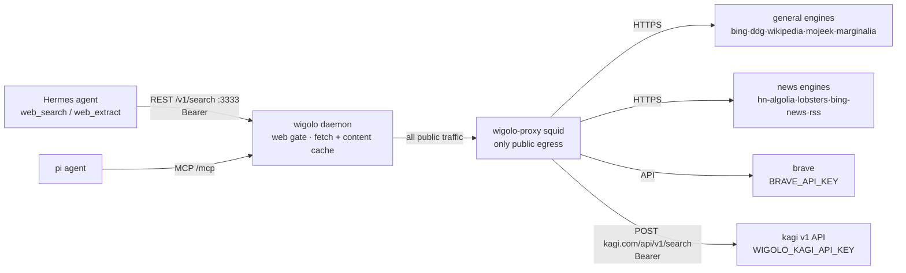
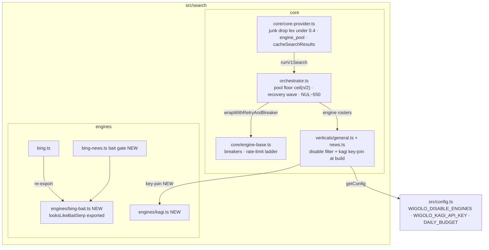
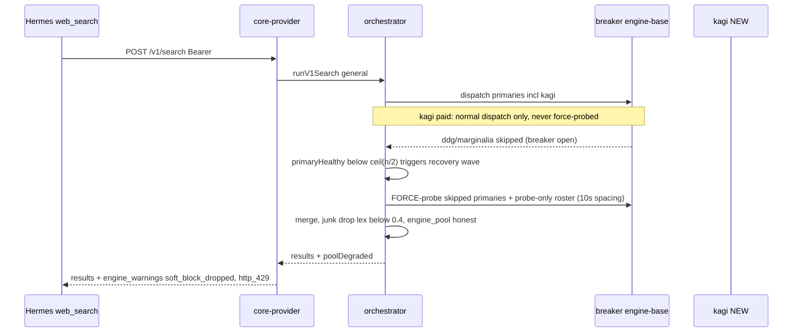

# Wigolo Search-Pool Health & Engine-Config — Design

> Status: **DRAFT v2 for owner approval** — nothing ships until this doc is approved (brainstorming hard gate).
> Last verified: `randomm/wigolo@09ae5b76` (= `v0.3.1-halo.3` = production image), 2026-11-14. Corrected against five independent read-only review lanes (builder-check, QA-scenarios, traceability, STRIDE/ops, diagram); their evidence lives in `/opt/data/cache/scratch/gate-*/`.
> Plan: `docs/superpowers/plans/2026-11-14-wigolo-search-pool.md` · ADRs: `docs/decisions/` · Readers: Janni (owner), implementing agent, halo-ops.

## 1. Introduction & Goals

wigolo is halo's **single web gate**: Hermes' `web_search`/`web_extract` ride it (strict provider pin, no keyless fallbacks), so its engine pool health *is* agent web quality. On 2026-11-13 the pool collapsed (0/5 contributors on general queries) and the one un-gated vertical shipped bait junk. This design makes the pool honest, operator-configurable, and adds a paid precision engine.

| # | Requirement | Priority |
|---|---|---|
| REQ-1 | Recovery wave performs **external probes** for breaker-open engines; collapse verdict re-derived after the wave | must |
| REQ-2 | No bait/blocked SERP ships results in any vertical (news included); every dropped engine surfaces a **caller-visible warning code**, not just a journal line | must |
| REQ-3 | Sustained rate-limiting escalates to chronic (`sessionTrips ≥ 3`); isolated 429s still recover fast | must |
| REQ-4 | Operator disables any engine / joins optional engines purely via env or config.json, footgun-guarded; the **effective engine policy** (disabled list, active optional engines, kagi spend) is surfaced in the health digest and weekly report | must |
| REQ-5 | Kagi v1 Search API joins general **and** news pools iff `WIGOLO_KAGI_API_KEY` set | should |
| REQ-6 | Kagi Results are never persisted (ToS): a real in-memory tier ≤60 s exists; Kagi `/extract` unused; daily spend guard that survives restarts | must |
| REQ-7 | Everything ships via the gate: lint green + unit failures ⊆ base tag; owner hand-merge, owner promote; candidate-identity assert; rollback **rehearsed**, not just named | must |
| REQ-8 | Brave joins the general pool via key today (pool relief, zero code) | must |
| REQ-9 | Every engine's egress provably proxied through `wigolo-proxy` (upstream #629); fix if bypassed | must |
| REQ-10 | **Every metered engine** (brave AND kagi) forced-probe-excluded — brave's exclusion asserted on the **real class** (`BraveEngine.metered === true`); kagi additionally USD-budget-capped with fail-closed ledger | must |

## 2. Constraints

- **Fork trunk model** (FORK.md): `main` = upstream + our commits; Mac session owns the rebase ritual; **halo never pushes `main`**; halo tooling fetches only. Production images only from gated tags `vX.Y.Z-halo.N`. Every carry/cherry-pick is registered in FORK.md's divergence register **in the same commit** (ADR-0002).
- **Candidate-reuse hazard** (verified by STRIDE lane): `wigolo-maint` keys candidates on `version|base|forktag@commit|recipe_sha` and returns `already-tested` on a repeat, and `fork_build()` builds from the **highest remote `-halo.N` tag** — a wave-1 image can therefore satisfy wave-2's promote unless the candidate's `fork_commit` is asserted equal to the wave tip (QS-7a). `cmd_rollback` **swaps** current/previous — running it twice re-promotes the bad build (QS-7d).
- **Runtime floors**: `package.json engines.node >= 22` (prod runs v24); playwright pinned `1.60.0`.
- **Egress design**: wigolo container has no direct DNS by design; public web only via `wigolo-proxy` squid. Caveat: engines call bare `fetch()` with no dispatcher today — "via squid" is design intent, **not yet proven**; REQ-9 audits it. Squid is **CONNECT-only** (no ssl_bump): audits can assert hosts, never URL paths — path assertions belong in unit mocks.
- **Tool traps**: `orchestrator.ts` has a literal NUL byte (~`:550`) **and `src/cache/store.ts` at `:412`** (inside the cache-key template; `:1077` is just the file's total line count) — `grep -a` or those files are silently skipped (this exact trap falsifies the QS-6 disk audit). `GET /health` is unauthenticated (`src/daemon/http-server.ts:208`); `POST /health` 404s.
- **Approval reality**: host-side work is `hostctl run`-gated and the ask channel has lapsed before (never auto-resend — one chat line, zero executed commands). `hostctl logs`/`podman-ps` are free. **Rollback itself needs approval** → rollback scripts are pre-staged and pre-approved before anything risky runs.
- **Secrets**: podman `Secret=…,type=env,target=…` (the actual `WIGOLO_API_TOKEN` precedent), never literal `Environment=KEY=*** values never in git, the OPEN-LINK diff (name only), archived logs, or artifacts.
- **Docs are evidence**: this doc set is committed to git (Task 0.0) before execution starts — untracked markdown is post-hoc editable and worthless as an audit trail; owner acks then point at a commit SHA, not agent-writable run notes.

## 3. Context & Scope (C4 — System Context)

All egress funnels through squid — that is the topology REQ-9 must prove, not assume (diagram lane: arrows are verified imports/edges; the squid fan-out is the claim under audit). In scope: search-pool logic (`src/search/core/`), two engines, config surface, release waves, the egress audit. Out of scope: other verticals' rosters (docs/images/code/papers — swept for zero-change by QS-2e), Hermes-side routing (unchanged), upstream `main` rebase (Mac-owned), plugin-engine migration (ADR-0001 debt).

## 4. Solution Strategy

| Goal | Approach | Mechanism |
|---|---|---|
| Honest recovery | Cherry-pick the stranded force-probe fix | upstream tag `binary-v0.2.1-sd507.1`: `68558c33` (force-probe, 10 s spacing) + `09b486ca` (collapse verdict post-wave); falsifiable via force-open smoke fixture with breaker-open evidence precondition (QS-1b) |
| No bait anywhere | Hoist bait gate to shared module; apply to `bing_news`; captcha-as-error; degraded-pool junk drop `lex < 0.4` | ADR-0002 (carry of upstream PR #637, head `328bc85b`, `mergeable:false` — we carry, upstream merges later) |
| Escalate sustained throttle | Consecutive-throttle counter in the rate-limit branch → hard-fail ladder after N=5 | new branch logic in `engine-base.ts`; existing `RATE_LIMIT_MAX_COOLDOWN_MS=30_000` cap must not be smuggled past on the non-sustained path |
| Operator control | `WIGOLO_DISABLE_ENGINES` + key-gated optional engines | filtered in the two vertical builders **before** their memoization (`general.ts:25,28`); footgun guards; policy line in health digest/weekly (REQ-4) |
| Paid precision | In-tree engine + a genuinely new ≤60 s memory result tier + restart-safe spend ledger | ADR-0001 + ADR-0003 |
| Safe rollout | Two waves; ancestor-assert, candidate-identity assert, rehearsed rollback, pre-staged kill-switches | ADR-0004 |

## 5. Building Block View

Arrows mean *depends on / imports* (verified by the diagram lane against real imports: `core-provider.ts:18` imports `runV1Search`; `orchestrator.ts:72-73` imports the roster builders; verticals import `getConfig`; `config.ts` imports nothing from search).

| Block | Change | Notes |
|---|---|---|
| `orchestrator.ts` | force-probe recovery dispatch; post-wave collapse re-derivation; **metered engines excluded from the probe roster** (new `metered` engine flag — brave carries it from wave 1, kagi from wave 2) | upstream-bounded: licensed on the collapse branch only, `FORCED_PROBE_MIN_SPACING_MS = 10_000`/engine (no invented per-query cap); probe roster = skipped primaries **plus** the held-out probe-only engine |
| `core/engine-base.ts` | consecutive-throttle counter in the rate-limit branch (`:287-294`) only; feeds `trips`/`sessionTrips` so chronic (`sessionTrips ≥ CHRONIC_TRIP_THRESHOLD=3`) is reachable; success between resets counter | `FailureClass` stays `'rate-limit'\|'forbidden'\|'other'` (`:197`) — captcha throws map to `other`; do not fork the taxonomy; ladder cap `MAX_COOLDOWN_MS=180_000` |
| `engines/bing-bait.ts` (new) | owns and exports `looksLikeBaitSerp` | `bing.ts` **re-exports** it so `tests/unit/search/engines/bing-bait.test.ts`'s import from `bing.js` stays green (file exists, verified) |
| `engines/bing-news.ts` | bait gate + UA rotation on retry mirroring the **`onRetry` override at `bing.ts:80-83`** (`:130-149` is the bait-retry block which reuses `this.userAgent` — copying it alone ships an identical retry UA); organic `li.b_algo` fallback only when news cards exist | today: 135 lines, upstream-identical, single UA (`:84`), fallback at `:103` |
| `engines/kagi.ts` (new) | metered engine: `static metered = true`, `static transientResultsOnly = true`, forced-probe-excluded, spend ledger | host **TBC before ship** — research lane read `kagi.com/api/v1/search`; the `api.` variant appears in older notes (owner confirms from live docs; QS-6c pins one host in test config); map `data.search[]` → `RawSearchResult` (`title`,`url`,`snippet`,`relevance_score`,`engine` all required per `types.ts:937-941` — synthesize `snippet:''`, `relevance_score:0`); 401 path caught **inside the engine** (**module-level counter SHARED across both roster instances** — per-instance counters would need up to 6 401s, same bug class as the ledger; 3 consecutive ⇒ park 15 min, return `[]` + one warn, nothing thrown ⇒ `recordFailure` never sees it, breaker row stays clean-but-present — asserting "no snapshot row" is impossible since the wrapper creates state on first call; resolves design↔plan mechanism drift D8) |
| `core/core-provider.ts` | degraded junk drop `lex < 0.4` + `degraded_pool_low_lexical` signal (`hybrid/signals.ts`) + `**cache write guard at `cacheSearchResults` (`:776`, `enginesUsed` is already a parameter) | single choke point; legacy searxng writers (`src/search/legacy/searxng-orchestrator.ts:333,558`) are unreachable under `WIGOLO_SEARCH=core` — comment only, do not touch |
| `src/cache/store.ts` + new memory tier | in-memory search-result cache (TTL ≤60 s) for `transientResultsOnly` engines | **none exists today** — the only cache is SQLite `search_cache` with `CACHE_TTL_SEARCH=86400` (**24 h**, `config.ts:648`; the earlier "20-min" claim was wrong and understated the mixed-query side effect ~72×). Building this tier is part of REQ-6, not a follow-up |
| `engines/duckduckgo.ts`, `mojeek.ts`, `engines/user-agents.ts` | captcha-as-error via `isCaptchaHtml` (new helper) | `user-agents.ts` lives in `engines/`, **not** `util/` |
| `src/config.ts` | `WIGOLO_DISABLE_ENGINES`, `WIGOLO_KAGI_API_KEY`, `WIGOLO_KAGI_DAILY_BUDGET_USD` | precedents: envBool `:639`, braveApiKey `:673`; `resetConfig()` is at **`:830`** (not 601-604); precedence env > config.json > default |
| `verticals/general.ts` / `news.ts` | apply disable filter + kagi key-join at construction, before the `:25,28` memoization | test resets: `resetConfig()` + `_resetGeneralEnginesForTest` (`:61`) / `_resetNewsEnginesForTest` (`:79`) |

## 6. Runtime View (one collapsed-pool query, post-change)

## 7. Deployment View

Quadlet container on `wigolo-net` (`localhost/wigolo:current`, `--memory=` cap); secrets via podman secrets (see `WIGOLO_API_TOKEN` precedent); hermes container reaches `http://wigolo:3333`. `/home/janni/outputs/wigolo/` is the host-visible artifact exchange (run notes, candidate JSONs) — **it is agent-writable, which is the real hazard**: a staged `hostctl run` script can be rewritten between owner approval and execution (TOCTOU; no container mount involved). Therefore every staged script carries a sha256 recorded in the chat ask text, and **the owner/agent compares `sha256sum <script>` against the ask OUTSIDE the script** — self-verification inside the script is a tamper-evident tripwire (whoever can rewrite the script can rewrite its digest check), not tamper-proof. Two quadlet copies exist (live `~/.config/containers/systemd/hermes/` vs `server-docs/containers/hermes/quadlet/`, identical today, nothing keeps them so) — env edits name the exact path **and** diff against the git copy. Throwaway smoke containers: unique name prefix, no published ports, ≤25 query calls (shared egress IP), 0 Cloudflare-fronted hosts, removed after (`podman ps -a` back to baseline).

## 8. Crosscutting Concepts

- **Honesty over availability**: empty-and-honest beats confident junk — and an honest-empty response is *correct behavior*, so the acceptance battery must not fail on it (QS-17 replaces the old unconditional `healthy ≥ 1` rule; the 2026-11-13 incident was honest-empty *plus* bait junk — both shapes must be distinguishable in telemetry).
- **Metered is metered**: every paid engine — brave and kagi alike — is forced-probe-excluded (brave's exclusion asserted on the real `BraveEngine` class, not just a fake); kagi additionally carries the USD budget, brave's metering is bounded by dispatch rate + exclusion + 10 s spacing (no `BRAVE_*` USD knob exists today — a call-budget is a named follow-up, REQ-10 is exclusion-only for brave). At 10 s spacing an un-guarded engine can emit 8,640 metered calls/day/engine (51,840/day across a 6-engine pool); forced probes must never be the cause.
- **Transient for paid content**: memory tier ≤60 s, no disk for result bodies ever; spend state lives **outside process memory** (an in-process counter resets on OOM — under the `--memory=` cap, OOM is exactly when restart spend is highest — and per-roster-instance counters double the cap since kagi joins both verticals).
- **Approval hygiene**: one staged script per `hostctl run` approval (≤4000 chars, sha256 in the ask), exactly two owner-initiated asks per wave (merge link, promote), lapsed asks never auto-resent (QS-16).
- **Journal hygiene**: the daemon journal already logs **full query text** (observed: 30 query payloads incl. research queries in a 258-line window); nothing goes through the web gate that must stay private, and archived artifacts keep counts/verdicts only (QS-6d), with the zero-hit grep running as an **exiting gate step**, not an attached note (QS-14).

## 9. Design Decisions (ADRs)

- **ADR-0001** In-tree Kagi engine + config-driven disable (vs plugin engine / SearXNG sidecar) → Accepted
- **ADR-0002** Carry PR #637 + cherry-pick binary-train force-probe fixes as fork commits, each registered in FORK.md's divergence register → Accepted
- **ADR-0003** Kagi ToS posture: real ≤60 s memory tier, no `/extract`, restart-safe pre-increment budget, metered-engine parity (brave too) → Accepted
- **ADR-0004** Two gated waves: ancestor-assert, candidate-identity assert, rehearsed rollback, pre-staged kill-switches → Accepted

## 10. Quality Requirements (measurable scenarios)

Every scenario is stimulus → response → target; adjective-only NFRs are not allowed to survive this table.

| ID | Stimulus | Response | Target |
|---|---|---|---|
| QS-1a | 3 primaries driven breaker-open + probeOnly engine, fresh query (unit, fake timers, fake engines) | recovery wave dispatches every skipped primary; verdict derived **after** wave | **(i)** ≥1 unwrapped `engine.search` call per skipped primary + ≥1 for the probeOnly engine in the same dispatch (separates the fix from today's no-op, which makes 0 external calls); (ii) 0 external calls for non-skipped engines; (iii) fake clock 60 s × 10 repeat queries: ≤6 probes/engine/min AND ≥10 000 ms between consecutive probes of one engine; (iv) ≥1 probe with ≥1 result ⇒ `pool_degraded.reasons` excludes `pool_collapsed`, all failing ⇒ includes it; (v) wave runs once per dispatch |
| QS-1b | Candidate smoke with **force-open fixture, mechanism world-aware** (bare-fetch world — pre-1.4b: `extra_hosts` dead-host overrides in the throwaway; dispatcher world — post-1.4b: `extra_hosts` is INERT, squid resolves destinations itself, so the throwaway's `wigolo-proxy` alias is an owner-approved fault-injection CONNECT-proxy) + **breaker-open evidence asserted FIRST** (per target engine: snapshot OPEN or `skipped:true`+cooldown telemetry — a green over zero forced-open engines is vacuous) | force-probe lines in journal; collapse path re-answers | ≥1 external probe per forced-open engine; ≥8/10 general `resultCount>0` or honest-empty carrying degraded reasons; naturally-open variant recorded `NOT RUN` if not observed — the force-open fixture is the falsifiable test |
| QS-1c | Collapse-path query latency budget | probe wave bounded | probe wave receives an explicit per-wave `softDeadlineMs: 3000` override in `RunEnginesOptions` (today the recovery wave inherits the primary wave's `ENGINE_POOL_SOFT_DEADLINE_MS=3500`, `orchestrator.ts:91, :738-743` — collapse path ≈ 2×3.5 s + merge ≈ 7 s, so battery p95 < 8 s is reachable; v1's "unbounded 10 s awaited probes ⇒ ~22 s" was doubly wrong: 10 s is the engine timeout, not an awaited deadline, and `searchTotalTimeoutMs` does not bind this path) |
| QS-2a | 6 bait fixtures (real `lexicalAlignment()`, mean <0.05, ≥3 results; 3 bing + 3 bing_news) + **2 genuine-SERP controls** | UA-rotation retry once, then contribution dropped | bait ⇒ `[]`, fetch exactly 2× with differing UA; controls ⇒ results unchanged AND 0 `soft_block_dropped` (false-positive control); news page with only `li.b_algo` cards ⇒ `[]` |
| QS-2b | Captcha HTML fixture (ddg, mojeek) | throws, breaker +1 | `classifyFailure === 'other'`, 0 results, no new FailureClass value |
| QS-2c | Degraded pool with fixtures that **explicitly set `evidence_score.components.lexical_alignment`** (the accessor defaults to 0 — band is unrepresentable otherwise) | lexical drop below threshold | 0.39 dropped, 0.41 kept, 0.40 boundary stated inclusive/exclusive and asserted; `degraded_pool_low_lexical` present |
| QS-2d | Any bait/degraded drop | **caller-visible warning** | `response.engine_warnings` contains `{engine, code:'soft_block_dropped'}` while `engine_telemetry` shows `result_count:0`; requires extending `buildEngineWarnings` (today: emits only for `outcome==='error'`; a bait drop is `ok` with 0 results) — a journal-only assertion does NOT satisfy this row |
| QS-2e | docs/images/code/papers queries | untouched verticals | those rosters deep-equal their pre-change baseline — 0 engines added/removed |
| QS-3 | 12 consecutive 429s from one engine; separately interleaved 429/success ×6 (fake timers) | 1–5 ⇒ `cooldownMs=5000`, trips 0; 6th ⇒ ≥60 000 AND `trips≥1` AND `sessionTrips≥1`; 3 escalation events ⇒ `isEngineChronicallyUnhealthy()===true` | 12 consecutive: no cooldown >180 000 ms, class stays `'rate-limit'`; non-sustained path keeps `RATE_LIMIT_MAX_COOLDOWN_MS=30_000`; interleaved: all 5000, trips 0 (success resets); `MARGINALIA_MIN_INTERVAL_MS=2000` still enforced |
| QS-4 | Disable-list — **six cases**: unset / typo (`bingg`) / disable-all / subset / env-vs-config precedence / normalization (`' Bing ,, duckduckgo ,, ddgX '`) | unchanged+one warn listing valid names / error + UNfiltered roster / exact subset in **both** verticals / env wins both directions / normalized (registered name is `duckduckgo` — `duckduckgo.ts:20`; `ddg` is not an alias and must land as the unknown token) | unset ⇒ roster serialization (names+weights+secondary+probeOnly+quality, both verticals) deep-equals a committed golden; a typo never silently drops a *valid* name alongside it (mixed list applies valid tokens, wholly-unknown list is a no-op + warn); every flip preceded by `resetConfig()` (`config.ts:830`) + `_reset*EnginesForTest()`; same-process re-build without resets demonstrates the memoization trap (documented), with resets returns the new roster |
| QS-5 | Kagi 401s ×2→3 / hanging fetch / breaker purity / recovery-wave participation (mocked fetch, fake timers) | 2×401 still dispatch; 3rd ⇒ parked: `[]` in <50 ms, 0 fetch, 1 warn per park; boundary park+14:59 ⇒ `[]`, +15:00 ⇒ exactly 1 fetch; success between 401s resets counter | `getEngineSessionTrips('kagi')===0` AND the `getBreakerSnapshot()` kagi row shows state `closed`/failures 0 (a row necessarily EXISTS — the wrapper creates breaker state on first call, `engine-base.ts:304-305, :355-372`; asserting absence is vacuous); hanging fetch settles `[]` ≤10.1 s **without** parking; **0 kagi `engine.search` calls inside the QS-1a recovery wave; same assertion for brave** (REQ-10) |
| QS-6a | 5 kagi-answering queries against the candidate (integration, throwaway) | **SQLite asserts, not grep** | via better-sqlite3 on `<dataDir>/wigolo.db`: `SELECT count(*) FROM search_cache WHERE engines_used LIKE '%"kagi"%'` = 0; same for `query_hash`; re-asserted after WAL checkpoint; mixed kagi+free query ⇒ total rows for that `query_hash` = 0 too |
| QS-6b | Same kagi query at t, t+59 s, t+61 s, fresh process | memory serve | 0 fetch at t+59 s, 1 at t+61 s, exact fake-timer boundary (hit at 60_000 ms, miss at 60_001 ms — literalizes "≤60 s"), 1 in fresh process — proves the ≤60 s tier exists (a 20-min TTL FAILS this row) and no persistence |
| QS-6c | Every kagi call (unit mocks) | pinned endpoint | every fetch path exactly `/api/v1/search`; 0 `/extract`; 0 hosts beyond the single pinned Kagi host (production-level assertion is host-only: squid is CONNECT-only, path invisible — unit mocks own the path claim) |
| QS-6d | Artifact hygiene | 20-char substring probe from every fixture title/url/snippet | 0 hits across every archived artifact; `grep -aiE 'authorization\|bearer'` zero-hit; assertion runs as an **exiting step**, non-zero on hit (QS-14), remembering `store.ts` NUL trap (`grep -a`) |
| QS-6e | Budget: `WIGOLO_KAGI_DAILY_BUDGET_USD=1.0`, cost pinned `$0.012/query` (=$12/1k, one constant, asserted); across a daemon restart | pre-increment, shared, persistent | predicate `spent + cost <= budget` (83rd query at 0.996 dispatches; 84th refused, 0 fetch, 1 warn not 84); ledger **outside process memory** and **shared across both roster instances** (per-instance counters double the cap to $1.992/day); `BUDGET=0` ⇒ 0 fetch ever; UTC-day reset; free engines unaffected; **ledger corrupt/missing/unwritable ⇒ FAIL CLOSED** (0 fetch, warn, REQ-4 digest line shows fail-closed — a parse failure read as $0 is a silent cap reset in exactly the OOM scenario this row exists for); **parked ⇒ no charge (return before the predicate), attempted fetch incl. 401 ⇒ charged** |
| QS-7a | Wave tagging | candidate provenance | `candidates/<tag>.json` `status==='pass'` AND its `fork_commit` equals wave tip read from `git ls-remote --tags origin` (peeled); `blocked`/`already-tested`/mismatch ⇒ promote **refused** with reason in run note (defends the `fork_build()`-highest-tag + `already-tested` reuse hazard) |
| QS-7b | Promote, before any "live" wording | six-value identity check | `.Created` > promote start; `.Image` id == candidate `image_id`; label `wigolo.commit` == wave tip AND ≠ Containerfile default `"unknown"`; `/health` 200 `status:"healthy"`; one live `/v1/search` `resultCount>0` **or the QS-17 honest-empty shape** (a concurrent honest collapse must not fail identity and falsely block QS-12); all six recorded in run note; owner ack quotes them |
| QS-7c | Promoted build misbehaves | auto-rollback per the **real** `prod_watch` trigger: functional search/fetch http≠200, or `NRestarts`↑, or journal node_crash, 600 s watch @30 s | promote exits non-zero; `current` re-tagged to `previous_tag` + restart; `/health` 200 ≤120 s; `state.json.failed_promotions` gains entry; running image id == pre-promote id |
| QS-7d | Rollback | **rehearsed once before wave-1 promote**, not just pre-staged | rehearsal exits 0, container recreated, `/health` 200 ≤120 s; missing `state.json.previous_tag` ⇒ refuse non-zero (never restart an unnamed image); double-run cannot re-promote the bad build (toggle guard lives in the **pre-staged wrapper** — `cmd_rollback` itself, `:740-753`, has no guard beyond the missing-`previous_tag` refuse; wrapper records promoted image id, second rollback without an intervening promote is a refusal; the rehearsal's **restore leg is an owner-initiated re-promote of the same tag**); rollback-image retention made REAL via a pre-approved host-tool change adding a `pin_previous` state flag honored by cleanup (today `:769-781` `podman rmi`s previous at age≥7d∧crash-free unconditionally — a claim without the flag is fiction), asserted `previous_removed=false` through the watch window |
| QS-8 | Load: relevance bench + synthetic collapse harness (NOT 100× live traffic from the shared egress IP — that violates the ≤25-call rule) | measured at pinned n | free-engine p95 < 8 s (n + method pinned: battery JSON, end-to-end `/v1/search` wall time); kagi/brave spend 0 during forced collapse probes (QS-5) |
| QS-9 | Wave-0 Brave env goes wrong: unit unhealthy OR brave 403/429 ×3 consecutive marker queries | restore named `.bak` + dryrun + restart | unit active + `/health` 200 healthy ≤120 s; marker query `resultCount>0` with brave absent from roster; declare-rollback→healthy ≤10 min; run note: `.bak` path, both `.Created` values, zero-hit grep; **the rehearsal must assert the RESTORE leg, not just the edit leg**, diff both quadlet copies against the `server-docs` git copy, and run a functional probe (search+fetch answer, like `prod_watch` does) — `/health` alone passed while the 2026-11-09 LLM-key regression would have hidden |
| QS-11 | Egress audit (REQ-9) | every engine host proven via squid | 100% of (bing, ddg, wikipedia, mojeek, marginalia, brave, hn-algolia, lobsters, bing-news, the live RSS-feed hosts from the `news.ts:64-73` list, kagi host when keyed) as `TCP_TUNNEL/200`, ≥1 line per host **per audit-run** (not per-query — mojeek is probe-only by default `config.ts:639`, visible only during collapse), **fresh-marker queries only** (a 24-h cache hit would fake "bypass confirmed"); container negative control: 0 engine-IP connections whose next-hop isn't `wigolo-proxy:3128` (conntrack/`/proc/net/tcp`, instrument named in run note); expected-host allowlist flags unreviewed egress (observed today: `incoming.telemetry.mozilla.org` ×47 — disposition recorded); until this passes, QS-1/2/3 telemetry reported untrusted |
| QS-12 | Any QS-7b value wrong | checker refuses "live" | mismatch + 3 observed values in run note; pre-staged rollback ≤5 min; `/health` ≤120 s; promote recorded failed; negative test of the checker itself once per wave (deliberately wrong SHA ⇒ must fail) |
| QS-13 | Wave-1 and wave-2 branches both exist | push-time ancestor gate | before wave-2's first push, `git merge-base --is-ancestor <wave-1-tip> <wave-2-tip>` == 0 else push exits non-zero; tag batch aborts **before** `wigolo-fork tag` on ancestor failure (0 new tags afterwards, "aborted: not ancestor" run-note line); `wigolo-fork status --json` `fork_main_ahead/behind` recorded before+after, 0 unexpected delta |
| QS-14 | Secret/artifact gate over a wave's scripts, logs, candidate JSONs, run notes, **and the live daemon journal (`hostctl logs wigolo.service`)** | exits 1 before archiving | 0 `authorization\|bearer` (case-insensitive) — the journal is included because engine error paths can echo request headers and kagi is the new fetch surface; 0 matches for first 8 chars of every used key (probed from host env file without printing values) |
| QS-15 | Smoke containment | per wave | 1 throwaway, unique prefix ≠ prod, `.HostConfig.PortBindings` empty, ≤25 `/v1/search` calls **per smoke container** counted from **daemon dispatch lines** (squid lines measure per-engine fan-out, not inbound calls — counting those would let one query masquerade as ten), 0 Cloudflare-fronted requests, removed after; wave-1 runs the egress audit + smoke sequentially, each budgeted |
| QS-16 | Approval hygiene | per wave | exactly 2 owner-initiated asks (merge link, promote) + the pre-declared batch; 0 auto-resends (lapsed ask ⇒ one chat line, `hostctl logs` count 0 executed in window); one staged script per approval, each ≤4000 chars, sha256 in the ask |
| QS-17 | All engines dropped for a fresh query | honest-empty is a PASS | `resultCount===0`, `pool_degraded.reasons` includes `pool_collapsed`, one warning with non-empty `code` per dispatched engine, 0 below-threshold results reached caller; battery rule relaxed from unconditional `engine_pool.healthy ≥ 1` to ≥1 healthy **OR** this honest-empty shape |
| QS-18 | Origin story on promoted prod: songbook "Queen Who Wants to Live Forever chords lyrics", 3 consecutive runs | same verdict all three | ≥3 of top-5 from chord-capable domains with ≥2 query tokens in title/snippet; 0 top-5 results with 0 token overlap; harness contains 0 `curl` escape hatches (grep it); deltas vs 2026-11-13 baseline (pool-degraded ~37/4h) reported from `health/<date>.json` **with a freshness assert** (file mtime < 26 h — a dead collector is not green) |

## 11. Risks & Tech Debt

| Risk | Mitigation |
|---|---|
| Wave-0 quadlet edit strands halo — no auto-rollback on the env path, and rollback itself needs a fresh approval | dryrun + **executed** edit→restart→**restore**→re-assert rehearsal incl. functional probe + git-copy diff (QS-9); rollback script pre-staged/pre-approved before the edit; env-file existence+parse assert pre-restart |
| False promote: tag cut before merge; Mac rebase orphans SHAs; **candidate reuse via `fork_build()` highest-tag + `already-tested`** | ancestor-assert + `wigolo-fork status` in the approved batch; QS-7a candidate `fork_commit` == tip (peeled `ls-remote`); "no rebase during promote window" note; QS-13 push-time ancestor gate for the divergent-branch case |
| Flagship force-probe fix promoted unexercised (cherry-picks live on an unmaintained binary lineage; mis-port passes gate⊆base, unit tests, smoke, identity check) | force-open smoke fixture with breaker-open evidence precondition, world-aware mechanism, makes the fix falsifiable (QS-1b); mirror spacing test under concurrency (shared spacing state); carry registered in FORK.md (ADR-0002) |
| Engines bypass squid (#629 true) | QS-11 with allowlist, fresh markers, conntrack negative control; if bypass confirmed, dispatcher fix gets its own commit + named test (repo has a pinned-dispatcher test precedent); REQ-1/2/3 telemetry declared untrusted until then |
| Kagi money fiction: no memory tier ⇒ repeat queries re-bill; per-instance in-process ledger ⇒ 2× understatement × restart multiplier; post-increment ⇒ $1.008 off-by-one | implement the ≤60 s tier (QS-6b), shared persistent ledger with pre-increment predicate (QS-6e), DoD may not assert a spend figure nobody collects — kagi spend lands in the REQ-4 `engine_policy` digest line from the ledger |
| CONNECT-only squid ⇒ path assertion theater at prod level | path claims asserted only in unit mocks (QS-6c); production asserts hosts only — stated in QS-6c so no one weakens the audit to "satisfied by wigolo-side logs" |
| `grep` silently skipping NUL-bearing files (`orchestrator.ts:~550`, `store.ts:412`) | `grep -a` mandatory everywhere, called out in the QS-6a instrument (SQLite asserts make this mostly moot for the disk audit itself) |
| Silent-dormancy: kagi over budget ⇒ `[]`+warn invisibility | warn rate pinned (1 per park/cap event, not per call); `engine_policy` digest line + weekly report surface disabled list, active optional engines, and kagi spend (REQ-4); pre-staged kagi kill-switch script (env-disable via `WIGOLO_DISABLE_ENGINES=kagi`) alongside wave-2 |
| Admin/MCP soft spots | `POST /admin/reset-breakers` clears chronic status (defeats REQ-3) — host-allowlist + on-disk token already gate it; **boot-time token-mode assertion** added to wave-0 checks: if the api-token secret is missing the daemon falls back to Host-allowlist/open mode on wigolo-net — assert token mode, else fail loudly |
| Plugin-engine path stale vs upstream `cba8623c` | debt note (ADR-0001 consequence): revisit migration at next upstream rebase; plan carries the pointer |
| Journal holds full query text; squid log reveals engine set + kagi CONNECTs | accepted, stated (nothing private goes through the gate); artifacts counts-only (QS-6d) |

## 12. Glossary

**bait SERP** — HTTP-200, well-formed but off-topic search page served to cookieless scrapers. **thin_pool / pool_collapsed** — pool-health reasons (≤2 contributors with a dropout / nobody answered). **forced probe** — recovery-wave dispatch that bypasses an open breaker, spacing-limited. **gate** — `wigolo-fork tag`'s lint + test-failure-subset check. **candidate** — built-but-unpromoted image + smoke JSONs. **transient-results** — memory-tier ≤60 s, never persisted. **metered engine** — any engine billed per call (brave, kagi): forced-probe-excluded, spend-capped, ledger persistent. **dead-host fixture** — throwaway-container host override that makes an engine host unreachable, forcing breakers open so recovery-wave tests are falsifiable (effective in the bare-`fetch()` world; post-1.4b the equivalent is a fault-injection CONNECT-proxy standing in for `wigolo-proxy` — QS-1b).
